# Combined Particle Swarm Optimization Algorithm with Chaotic Mutation and Cosine Variation for the Integration of Sparrow Following Mechanism Perturbation and Historical Position Map, and Mean Fitness Convergence Map in One Go, MATLAB Code

This issue article reproduces a newly published paper titled "Multi-Strategy Improved Gyrella Optimization Algorithm and Its Application," which was published in the Chinese core journal "Computers Science and Exploration" on December 15, 2023. The references are as follows:
[1] Guo Qin, Zheng Qiaoxiang. Multi-Strategy Improved Gyrella Optimization Algorithm and Its Application [J/OL]. Computer Science and Exploration, 1-22 [2023-12-19]
The article abstract is as follows:
The Dung Beetle Optimizer (DBO) is a recently proposed intelligent optimization algorithm. Like other optimization algorithms, DBO has its limitations such as low convergence accuracy and tendency to fall into local optima. To address these limitations of DBO, a Multi-strategy Improved Dung Beetle Optimizer (MDBO) is proposed. Firstly, the acceptance degree of local and global optima by the chick ball and the thief beetle is improved, allowing them to dynamically adjust according to their search capabilities. This not only enhances the quality of the population but also maintains the good search capability of individuals with high adaptability.Secondly, Perturb the algorithm by incorporating a follower position update mechanism from the fusion of MAZE search algorithms. And update the position with greedy strategy. Improved the convergence accuracy of the algorithm; Finally, When the algorithm is stuck, introduce the Cauchy Gaussian mutation strategy. Enhanced the algorithm's ability to escape local optima.
The Dung Beetle Algorithm has attracted numerous scholars' research since its introduction and is a popular algorithm. The basic principle of the Dung Beetle Algorithm can be referred to: Intelligent Algorithms - Dung Beetle Optimization Algorithm(DBO), Detailed explanation of the principle formulas, with appendixmatlabCode  
The principle of the multi-strategy improved ant optimization algorithm is as follows:
Improvement strategy
Improvement point 1: Enhance the acceptance of optimal solutions by chick balls and kleptocysts.
In the basic ant optimization algorithm, The position update is based on the local optimal position. Stealing Dung Beetle also update their positions based on the global optimal position. From this, The chick ball and the scavenger beetle will constantly move towards the local optimal position and the global optimal position. However, in the early stages of the algorithm. The search scope of the group should be expanded as much as possible. Although it can make the algorithm converge quickly, However, there is a certain probability that it will cause the algorithm to be stuck. Causes the algorithm to fail to converge to a global optimum solution.
Therefore, a strategy is designed to dynamically adjust the acceptance of local and global optimal positions by both the larva balls and the scavenging cephalopods based on their search capabilities (fitness values). The specific method involves sorting the cephalopod population according to their search abilities (based on fitness values), and updating the positions of both the larva balls and the scavenging cephalopods as follows:
Improvement point 2: Disturbance strategy integrated with the pursuit mechanism of the sparrow search algorithm
The Sparrow Algorithm has high accuracy of convergence. Fast convergence rate. Characterized by strong robustness, etc. In the aspect of function optimization problems, Superior to Particle Swarm Algorithm. Gray Wolf Optimization Algorithm and Other Particle Swarm Optimization Algorithms []. Therefore, The position update mechanism of followers in the squirrel optimization algorithm is introduced as a perturbation strategy. Define the discoverer's optimal position in the Sparrow Search Algorithm as the global optimal position in the Dung Beetle Optimization Algorithm. If the disturbance is too strong. Groups are prone to falling into a state of chaos and disorder. If the disturbance is too weak. The disturbance strategy will not be effective; Therefore, Adapt the perturbation probability according to the iteration depth. And adopts the greedy strategy to decide whether to retain this disturbance. The disturbance probability is shown in the formula:
In the early iterations, the perturbation probability is high, allowing for the full exploitation of the squirrel-following mechanism's role in perturbation, thereby enhancing the quality of the population and improving the algorithm's optimization performance. In later iterations, the perturbation probability gradually decreases, accelerating the convergence speed of the algorithm. The specific perturbation steps are as follows: a) Calculate the perturbation probability pv for individual i according to the formula above; b) Generate a random number r∈(0,1), if r<pv, proceed to step c), otherwise, do not perturb individual i; c) Generate a random number r1∈(0,1), if r1<ST, generate a new solution according to the second formula in the squirrel algorithm, otherwise, generate a new solution according to the first formula. Extensive experiments have proven that ST=0.7 yields the best results.This means that 70% of the individuals in the group will migrate towards the optimal position of the group. 30% of individuals exhibit a greater degree of positional variance than themselves. (d) Calculate the fitness value of the new solution. If the fitness value is better than before perturbation. Use the new solution to replace the solution before perturbation. Otherwise, This disturbance is invalid.
Improvement point 3: Cauchy Gaussian mutation
The disturbance introduced by the Sparrow Search Algorithm's pursuit mechanism primarily serves to enable the population to thoroughly explore the solution space, enhancing the quality of the population, akin to chaotic perturbation. In cases of multiple peaks, the Dung Beetle Optimization Algorithm and other swarm intelligence optimization methods similarly tend to fall into local optima. The Cauchy Gaussian mutation is proposed as an auxiliary strategy to address this issue, increasing the probability that the algorithm will escape from local optima.[3], Improve the optimization accuracy of the algorithm. After each perturbation of the flock search algorithm's follow-me mechanism, determine whether the population is prematurely matured. The method for determining this is: If the population has passed...5The optimal solution remains unchanged after the second iteration, indicating that the algorithm has hit a dead-end (early saturation). To overcome this issue, apply the Cauchy Gaussian mutation strategy to the entire population, enabling it to escape from local optima. The Cauchy Gaussian mutation method is described by the following equation.:   
Results display
The algorithm was tested on the CEC2005 function set and compared with the original Dung Beetle Algorithm (DBO), Sparrow Algorithm (SSA), Pelican Algorithm (POA), Racoon Algorithm (COA), and Subtraction Optimizer Algorithm (SABO). These algorithms are all recommended by the author in previous works, and their performance has been quite impressive!
Draw the function image, iterative curve, particle trajectory graph, average convergence graph and historical position graph. These figures are often involved in many intelligent algorithm literatures.
Tested in CEC2005:
F1:  
F2:  
F6:  
F5:   
F7:  
F9:  
F12:  
F13:  
F15:   
The above images and code can be run with a single click.
The CEC2005 indicator statistics are as follows:
Each algorithm is iterated 500 times, the population size is set to 30, each function runs 30 times, and the optimal value, standard deviation, mean, worst value, median are calculated. The results of rank sum test and box plot are as follows.
F1Function calculation results: \nMIDBO: Optimal value:0 Standard deviation:0 Mean:0 Median:0 Worst value:0\nDBO: Optimal value:1.6775e-157 Standard deviation:4.0998e-104 Mean:7.4957e-105 Median:4.3695e-131 Worst value:2.2457e-103\nPOA: Optimal value:5.1362e-121 Standard deviation:2.1177e-103 Mean:3.8826e-104 Median:2.19e-111 Worst value:1.1601e-102\nSSA: Optimal value:0 Standard deviation:3.6939e-70 Mean:6.7506e-71 Median:1.0776e-89 Worst value:2.0233e-69\nCOA: Optimal value:0 Standard deviation:0 Mean:0 Median:0 Worst value:0\nSABO: Optimal value:7.5261e-205 Standard deviation:0 Mean:1.8391e-199 Median:1.0383e-201 Worst value:2.9804e-198\nF2Function calculation results: \nMIDBO: Optimal value:0 Standard deviation:0 Mean:4.7163e-201 Median:0 Worst value:1.1333e-199\nDBO: Optimal value:1.1486e-84 Standard deviation:4.8833e-55 Mean:1.283e-55 Median:1.4611e-71 Worst value:2.032e-54\nPOA: Optimal value:8.0077e-61 Standard deviation:4.7725e-54 Mean:1.5814e-54 Median:4.4123e-56 Worst value:2.5383e-53\nSSA: Optimal value:1.5965e-131 Standard deviation:8.4806e-35 Mean:1.5524e-35 Median:1.6877e-42 Worst value:4.6454e-34\nCOA: Optimal value:8.3373e-196 Standard deviation:0 Average:2.3769e-180 Median:4.6145e-188 Worst value:7.0832e-179\nSABO: Optimal value:9.3956e-113 Standard deviation:1.4431e-108 Mean:5.1734e-109 Median:9.0048e-110 Worst value:7.9504e-108\nF3Function calculation results: \nMIDBO: Optimal value:0 Standard deviation:0 Mean:3.0344e-218 Median:0 Worst value:9.1031e-217\nDBO: Optimal value:5.0119e-150 Standard deviation:1.1918e-78 Average:2.1759e-79 Median:4.1655e-115 Worst value:6.5278e-78\nPOA: Optimal value:3.8386e-116 Standard deviation:1.4875e-105 Mean:3.7996e-106 Median:3.8399e-111 Worst value:7.7799e-105\nSSA: Optimal value:4.138e-105 Standard deviation:1.6966e-33 Mean:3.099e-34 Median:7.5835e-47 Worst value:9.2926e-33\nCOA: Optimal value:0 Standard deviation:0 Mean:0 Median:0 Worst value:0\nSABO: Optimal value:6.3111e-114 Standard deviation:5.2072e-85 Mean:9.8386e-86 Median:6.2376e-102 Worst value:2.8538e-84\nF4Function calculation results: \nMIDBO: Optimal value:0 Standard deviation:0 Mean:0 Median:0 Worst value:0\nDBO: Optimal value:5.2602e-82 Standard deviation:9.9275e-52 Mean:1.9529e-52 Median:6.1546e-65 Worst value:5.4363e-51\nPOA: Optimal value:1.4087e-62 Standard deviation:1.415e-52 Mean:4.0918e-53 Median:4.7814e-56 Worst value:6.0281e-52\nSSA: Optimal value:1.0452e-217 Standard deviation:5.764e-29 Mean:1.1294e-29 Median:2.2796e-48 Worst value:3.1576e-28\nCOA: Optimal value:4.1842e-193 Standard deviation:0 Mean:2.1174e-182 Median:7.638e-188 Worst value:5.7058e-181\nSABO: Optimal value:3.4047e-88 Standard deviation:3.4114e-84 Mean:1.7413e-84 Median:3.5102e-85 Worst value:1.6824e-83\nF5Function calculation results: \nMIDBO: Optimal value:0 Standard deviation:7.0601e-05 Mean:2.0971e-05 Median:0 Worst value:0.00034569\nDBO: Optimal value:4.8315 Standard deviation:0.27718 Mean:5.2879 Median:5.2615 Worst value:6.0842\nPOA: Optimal value:4.7765 Standard deviation:0.76761 Mean:6.3137 Median:6.2155 Worst value:8.9143\nSSA: Optimal value:1.7041e-10 Standard deviation:4.7784e-06 Mean:1.9968e-06 Median:1.4148e-07 Worst value:1.81e-05\nCOA: Optimal value:0 Standard deviation:0 Mean:0 Median:0 Worst value:0\nSABO: Optimal value:6.8856 Standard deviation:0.55816 Mean:7.516 Median:7.2887 Worst value:8.9185\nF6Function calculation results: \nMIDBO: Optimal value:0 Standard deviation:1.2826e-06 Mean:3.3059e-07 Median:2.627e-24 Worst value:6.7234e-06\nDBO: Optimal value:2.2786e-28 Standard deviation:1.0402e-23 Mean:2.5843e-24 Median:1.157e-25 Worst value:5.7074e-23\nPOA: Optimal value:5.6403e-07 Standard deviation:0.17224 Mean:0.15216 Median:0.095247 Worst value:0.50277\nSSA: Optimal value:0 Standard deviation:1.2477e-32 Mean:1.0682e-32 Median:1.2326e-32 Worst value:4.9304e-32\nCOA: Optimal value:0 Standard deviation:0 Mean:0 Median:0 Worst value:0\nSABO: Optimal value:0.00053409 Standard deviation:0.15653 Mean:0.10074 Median:0.0020809 Worst value:0.56967\nF7Function calculation results: \nMIDBO: Optimal value:3.2388e-06 Standard deviation:6.9476e-05 Mean:6.9199e-05 Median:5.1441e-05 Worst value:0.00036031\nDBO: Optimal value:0.00011126 Standard deviation:0.00086613 Mean:0.00099766 Median:0.00068401 Worst value:0.0030559\nPOA: Optimal value:1.1789e-05 Standard deviation:0.0001654 Mean:0.00020722 Median:0.00014035 Worst value:0.00063182\nSSA: Optimal value:0.00028315 Standard deviation:0.0012843 Mean:0.0014874 Median:0.0011822 Worst value:0.0051704\nCOA: Optimal value:2.4002e-06 Standard deviation:5.6158e-05 Mean:5.1631e-05 Median:3.5014e-05 Worst value:0.00020999\nSABO: Optimal value:1.8589e-05 Standard deviation:0.00010422 Mean:0.00011481 Median:8.7345e-05 Worst value:0.00046295\nF8Function calculation results: \nMIDBO: Optimal value:-4189.8289 Standard deviation:484.0229 Average:-3596.8958 Median:-3628.937 Worst value:-2455.6088\nDBO: Optimal value:-4188.9123 Standard deviation:548.9639 Mean:-3444.6425 Median:-3359.909 Worst value:-2402.6344\nPOA: Optimal value:-3439.3677 Standard deviation:210.0963 Mean:-3050.9842 Median:-3100.0672 Worst value:-2570.4931\nSSA: Optimal value:-3716.0755 Standard deviation:279.1991 Mean:-3297.5856 Median:-3328.8535 Worst value:-2762.4677\nCOA: Optimal value:-4189.8289 Standard deviation:0.0072914 Mean:-4189.8244 Median:-4189.8273 Worst value:-4189.7964\nSABO: Optimal value:-2300.2368 Standard deviation:215.7255 Mean:-1771.4858 Median:-1783.3412 Worst value:-1444.6423\nF9Function calculation results: \nMIDBO: Optimal value:0 Standard deviation:0 Mean:0 Median:0 Worst value:0\nDBO: Optimal value:0 Standard deviation:4.767 Mean:1.5925 Median:0 Worst value:16.9143\nPOA: Optimal value:0 Standard deviation:0 Mean:0 Median:0 Worst value:0\nSSA: Optimal value:0 Standard deviation:0 Mean:0 Median:0 Worst value:0\nCOA: Optimal value:0 Standard deviation:0 Mean:0 Median:0 Worst value:0\nSABO: Optimal value:0 Standard deviation:0 Mean:0 Median:0 Worst value:0\nF10Function calculation results: \nMIDBO: Optimal value:4.4409e-16 Standard deviation:0 Mean:4.4409e-16 Median:4.4409e-16 Worst value:4.4409e-16\nDBO: Optimal value:4.4409e-16 Standard deviation:0 Mean:4.4409e-16 Median:4.4409e-16 Worst value:4.4409e-16\nPOA: Optimal value:4.4409e-16 Standard deviation:1.7413e-15 Mean value:2.6941e-15 Median:3.9968e-15 Worst value:3.9968e-15\nSSA: Optimal value:4.4409e-16 Standard deviation:0 Mean:4.4409e-16 Median:4.4409e-16 Worst value:4.4409e-16\nCOA: Optimal value:4.4409e-16 Standard deviation:0 Mean:4.4409e-16 Median:4.4409e-16 Worst value:4.4409e-16\nSABO: Optimal value:3.9968e-15 Standard deviation:0 Mean:3.9968e-15 Median:3.9968e-15 Worst value:3.9968e-15\nF11Function calculation results: \nMIDBO: Optimal value:0 Standard deviation:0 Mean:0 Median:0 Worst value:0\nDBO: Optimal value:0 Standard deviation:0.032581 Average:0.015822 Median:0 Worst value:0.11782\nPOA: Optimal value:0 Standard deviation:0 Mean:0 Median:0 Worst value:0\nSSA: Optimal value:0 Standard deviation:0 Average:0 Median:0 Worst value:0\nCOA: Optimal value:0 Standard deviation:0 Mean:0 Median:0 Worst value:0\nSABO: Optimal value:0 Standard deviation:0 Mean:0 Median:0 Worst value:0\nF12Function calculation results: \nMIDBO: Optimal value:4.7116e-32 Standard deviation:2.255e-07 Mean:6.8509e-08 Median:1.7745e-23 Worst value:9.2705e-07\nDBO: Optimal value:2.7752e-31 Standard deviation:2.0232e-23 Mean:5.2084e-24 Median:2.4528e-26 Worst value:1.034e-22\nPOA: Optimal value:4.4907e-07 Standard deviation:0.01495 Mean:0.012946 Median:0.0082496 Worst value:0.043882\nSSA: Optimal value:4.7116e-32 Standard deviation:1.6013e-33 Mean:4.7963e-32 Median:4.7721e-32 Worst value:5.5829e-32\nCOA: Optimal value:4.7116e-32 Standard deviation:1.6702e-47 Mean:4.7116e-32 Median:4.7116e-32 Worst value:4.7116e-32\nSABO: Optimal value:0.0011942 Standard deviation:0.081093 Mean:0.070052 Median:0.062348 Worst value:0.46078\nF13Function calculation results: \nMIDBO: Optimal value:1.3498e-32 Standard deviation:1.6953e-06 Mean:3.9904e-07 Median:1.3498e-32 Worst value:9.2648e-06\nDBO: Optimal value:5.0104e-30 Standard deviation:0.064031 Mean:0.036817 Median:0.010987 Worst value:0.29369\nPOA: Optimal value:4.5528e-06 Standard deviation:0.19558 Mean:0.2747 Median:0.21728 Worst value:0.69548\nSSA: Optimal value:1.3498e-32 Standard deviation:8.2e-33 Mean:1.7031e-32 Median:1.3498e-32 Worst value:5.7871e-32\nCOA: Optimal value:1.3498e-32 Standard deviation:5.5674e-48 Mean:1.3498e-32 Median:1.3498e-32 Worst value:1.3498e-32\nSABO: Optimal value:0.01201 Standard deviation:0.088243 Mean:0.14026 Median:0.12958 Worst value:0.32048\nF14Function calculation results: \nMIDBO: Optimal value:0.998 Standard deviation:3.1549 Mean:2.4349 Median:0.998 Worst value:12.6705\nDBO: Optimal value:0.998 Standard deviation:1.8611 Mean:1.6212 Median:0.998 Worst value:10.7632\nPOA: Optimal value:0.998 Standard deviation:0.18148 Mean:1.0311 Median:0.998 Worst value:1.992\nSSA: Optimal value:0.998 Standard deviation:4.7322 Mean:3.7928 Median:0.998 Worst value:12.6705\nCOA: Optimal value:0.998 Standard deviation:1.2661e-10 Mean:0.998 Median:0.998 Worst value:0.998\nSABO: Optimal value:0.99952 Standard deviation:3.0776 Mean:4.0221 Median:3.034 Worst value:12.6705\nF15Function calculation results: \nMIDBO: Optimal value:0.00030808 Standard deviation:2.5342e-05 Mean:0.00032174 Median:0.00031106 Worst value:0.00040057\nDBO: Optimal value:0.00030749 Standard deviation:0.0003503 Mean:0.00072584 Median:0.0006719 Worst value:0.0014887\nPOA: Optimal value:0.00030749 Standard deviation:0.00027833 Mean:0.00040684 Median:0.00030749 Worst value:0.0012232\nSSA: Optimal value:0.00030749 Standard deviation:5.6349e-05 Mean:0.00032268 Median:0.00030749 Worst value:0.00056322\nCOA: Optimal value:0.00030869 Standard deviation:0.00017616 Mean:0.00046003 Median:0.00038628 Worst value:0.000881\nSABO: Optimal value:0.00032052 Standard deviation:0.00071998 Mean:0.00060695 Median:0.00041566 Worst value:0.0043519\nF16Function calculation results: \nMIDBO: Optimal value:-1.0316 Standard deviation:3.3195e-07 Mean:-1.0316 Median:-1.0316 Worst value:-1.0316\nDBO: Optimal value:-1.0316 Standard deviation:5.9752e-16 Mean:-1.0316 Median:-1.0316 Worst value:-1.0316\nPOA: Optimal value:-1.0316 Standard deviation:5.7578e-16 Mean:-1.0316 Median:-1.0316 Worst value:-1.0316\nSSA: Optimal value:-1.0316 Standard deviation:5.2964e-16 Mean:-1.0316 Median:-1.0316 Worst value:-1.0316\nCOA: Optimal value:-1.0316 Standard deviation:0.00022163 Mean:-1.0315 Median:-1.0316 Worst value:-1.0306\nSABO: Optimal value:-1.0316 Standard deviation:0.010608 Mean:-1.0252 Median:-1.0306 Worst value:-0.99286\nF17Function calculation results: \nMIDBO: Optimal value:0.39789 Standard deviation:0.00018219 Mean:0.39793 Median:0.39789 Worst value:0.39888\nDBO: Optimal value:0.39789 Standard deviation:0 Mean:0.39789 Median:0.39789 Worst value:0.39789\nPOA: Optimal value:0.39789 Standard deviation:0 Mean:0.39789 Median:0.39789 Worst value:0.39789\nSSA: Optimal value:0.39789 Standard deviation:0 Mean:0.39789 Median:0.39789 Worst value:0.39789\nCOA: Optimal value:0.39789 Standard deviation:0.0011571 Mean:0.3985 Median:0.39803 Worst value:0.4031\nSABO: Optimal value:0.39789 Standard deviation:0.14628 Mean:0.46505 Median:0.40319 Worst value:1.0174\nF18Function calculation results: \nMIDBO: Optimal value:3 Standard deviation:1.651e-06 Mean:3 Median:3 Worst value:3\nDBO: Optimal value:3 Standard deviation:4.9295 Mean:3.9 Median:3 Worst value:30\nPOA: Optimal value:3 Standard deviation:9.6523e-16 Mean:3 Median:3 Worst value:3\nSSA: Optimal value:3 Standard deviation:1.212e-15 Mean:3 Median:3 Worst value:3\nCOA: Optimal value:3 Standard deviation:0.49906 Mean:3.1412 Median:3.0153 Worst value:5.7574\nSABO: Optimal value:3.0009 Standard deviation:1.3271 Mean:3.826 Median:3.1621 Worst value:8.798\nF19Function calculation results: \nMIDBO: Optimal value:-3.8628 Standard deviation:0.0013834 Mean:-3.8619 Median:-3.8627 Worst value:-3.8572\nDBO: Optimal value:-3.8628 Standard deviation:0.0029875 Mean:-3.8615 Median:-3.8628 Worst value:-3.8549\nPOA: Optimal value:-3.8628 Standard deviation:7.0916e-09 Mean:-3.8628 Median:-3.8628 Worst value:-3.8628\nSSA: Optimal value:-3.8628 Standard deviation:2.3485e-15 Mean:-3.8628 Median:-3.8628 Worst value:-3.8628\nCOA: Optimal value:-3.8623 Standard deviation:0.057873 Mean:-3.8079 Median:-3.835 Worst value:-3.6702\nSABO: Optimal value:-3.8624 Standard deviation:0.22423 Mean:-3.5834 Median:-3.6525 Worst value:-3.0449\nF20Function calculation results: \nMIDBO: Optimal value:-3.3219 Standard deviation:0.089046 Mean:-3.2536 Median:-3.3205 Worst value:-3.0891\nDBO: Optimal value:-3.322 Standard deviation:0.08762 Mean:-3.2381 Median:-3.2031 Worst value:-3.0206\nPOA: Optimal value:-3.322 Standard deviation:0.036619 Mean:-3.31 Median:-3.322 Worst value:-3.1999\nSSA: Optimal value:-3.322 Standard deviation:0.057005 Average:-3.2824 Median:-3.322 Worst value:-3.2031\nCOA: Optimal value:-3.1986 Standard deviation:0.31671 Mean:-2.6682 Median:-2.6737 Worst value:-1.8233\nSABO: Optimal value:-3.3212 Standard deviation:0.09577 Mean:-3.2492 Median:-3.2981 Worst value:-3.0297\nF21Function calculation results: \nMIDBO: Optimal value:-10.1532 Standard deviation:0.0019794 Mean:-10.1519 Median:-10.1529 Worst value:-10.1461\nDBO: Optimal value:-10.1532 Standard deviation:2.5492 Mean:-7.49 Median:-5.8938 Worst value:-4.8115\nPOA: Optimal value:-10.1532 Standard deviation:0.00015988 Mean:-10.1531 Median:-10.1531 Worst value:-10.1526\nSSA: Optimal value:-10.1532 Standard deviation:2.5867 Mean:-7.7741 Median:-10.1522 Worst value:-5.0552\nCOA: Optimal value:-10.1532 Standard deviation:0.00015468 Mean:-10.1531 Median:-10.1532 Worst value:-10.1525\nSABO: Optimal value:-5.0546 Standard deviation:0.51974 Mean:-4.8898 Median:-5.0523 Worst value:-2.4236\nF22Function calculation results: \nMIDBO: Optimal value:-10.4029 Standard deviation:0.00086297 Mean:-10.4021 Median:-10.4023 Worst value:-10.3996\nDBO: Optimal value:-10.4029 Standard deviation:2.7609 Mean:-8.6502 Median:-10.4029 Worst value:-2.7659\nPOA: Optimal value:-10.4029 Standard deviation:1.3485 Mean:-10.0485 Median:-10.4029 Worst value:-5.0877\nSSA: Optimal value:-10.4029 Standard deviation:2.6052 Mean:-8.454 Median:-10.4029 Worst value:-5.0877\nCOA: Optimal value:-10.4029 Standard deviation:7.5104e-05 Mean:-10.4028 Median:-10.4028 Worst value:-10.4026\nSABO: Optimal value:-8.551 Standard deviation:0.84731 Mean:-4.8978 Median:-4.9982 Worst value:-3.0254\nF23Function calculation results: \nMIDBO: Optimal value:-10.5364 Standard deviation:0.001094 Mean:-10.5357 Median:-10.5359 Worst value:-10.5304\nDBO: Optimal value:-10.5364 Standard deviation:2.7505 Mean:-7.8949 Median:-9.3083 Worst value:-3.8353\nPOA: Optimal value:-10.5364 Standard deviation:7.4742e-05 Mean:-10.5363 Median:-10.5364 Worst value:-10.5361\nSSA: Optimal value:-10.5364 Standard deviation:2.5206 Mean:-8.914 Median:-10.5364 Worst value:-5.1285\nCOA: Optimal value:-10.5364 Standard deviation:0.00010112 Mean:-10.5363 Median:-10.5363 Worst value:-10.5359\nSABO: Optimal value:-9.984 Standard deviation:1.1931 Mean:-4.9761 Median:-4.9178 Worst value:-3.0507\nBox plot:   
After running, an Excel table will automatically appear to count the results of five indicators:
Wilcoxon rank sum test:
Code directory:
To run these two main programs!
All mentioned images, EXCEL tables, and code can be executed.

## Images

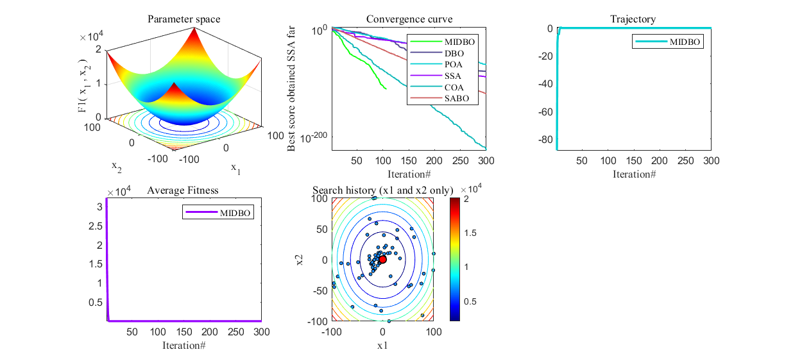
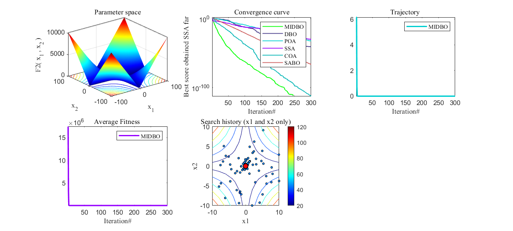
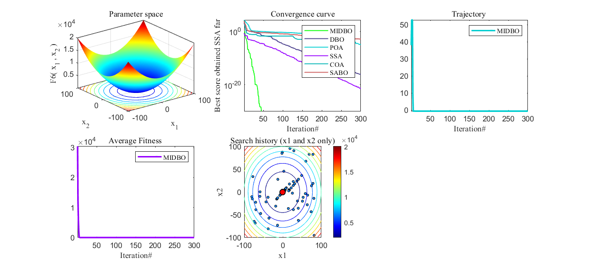
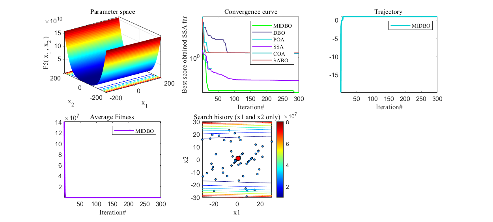
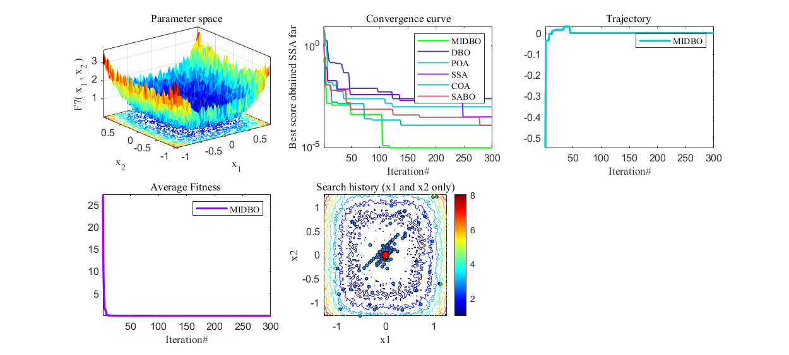
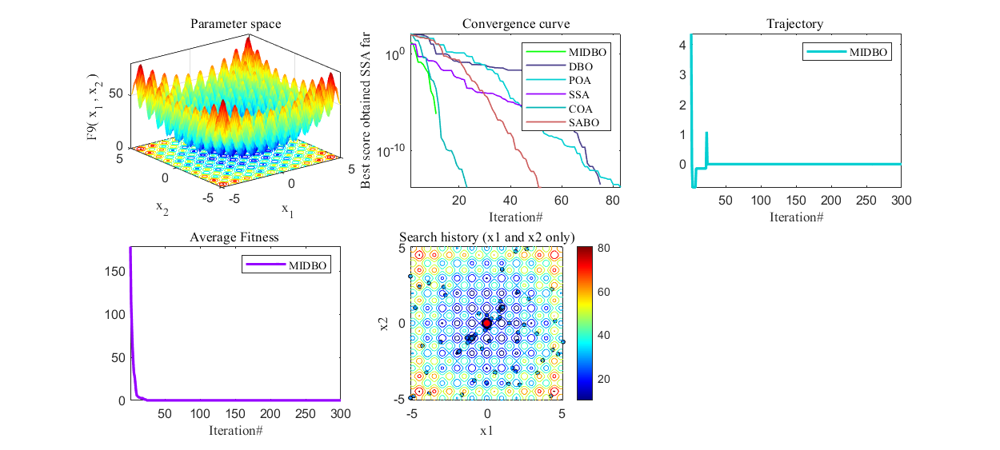

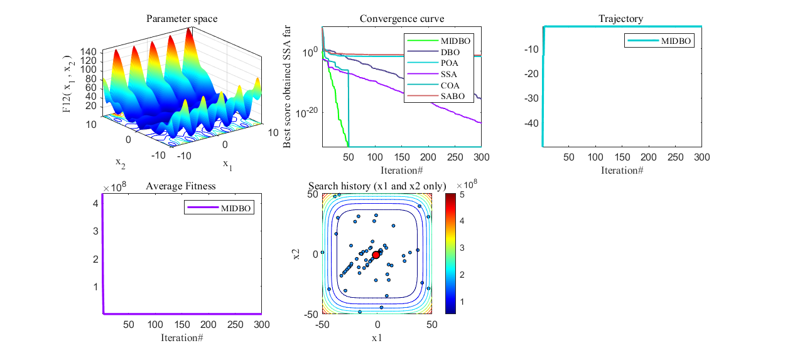
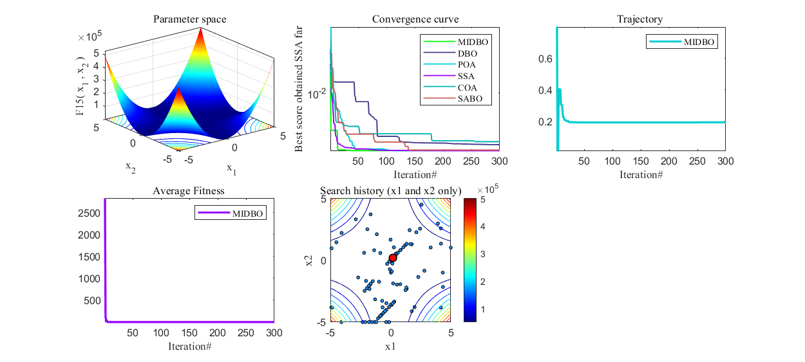
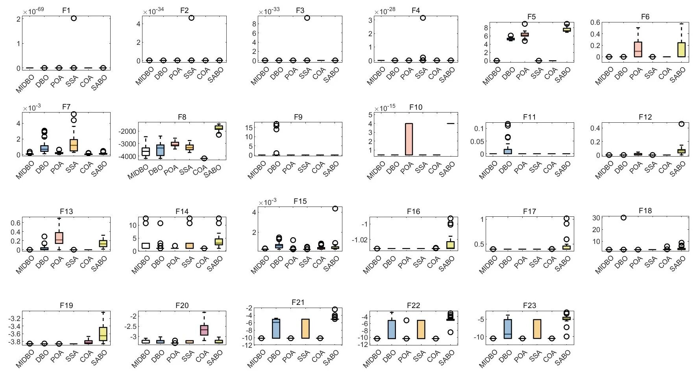
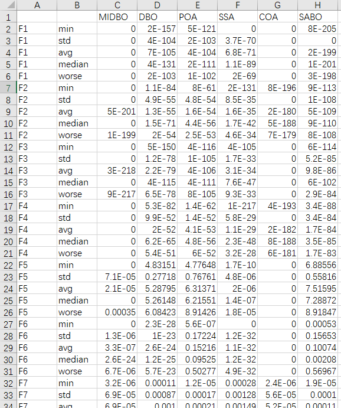
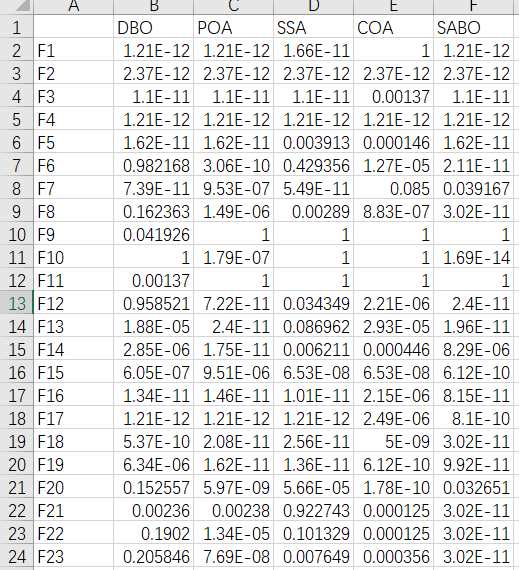

<!-- PAYMENT_BLOCK -->

## Get this dataset

- Payment link (Stripe): [Buy now](https://buy.stripe.com/3cs8yP7sY87d0vu9AB)
- Payment QR code: 

<!-- /PAYMENT_BLOCK -->
